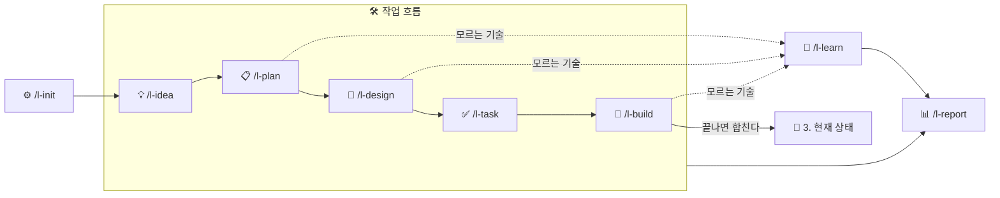

<div align="center">


<a href="https://pypi.org/project/lanternspec/"></a>
<a href="https://github.com/Jungjihyuk/LanternSpec"></a>
<a href="https://github.com/Jungjihyuk/LanternSpec/blob/main/LICENSE"></a>


[English](https://github.com/Jungjihyuk/LanternSpec/blob/main/README.md) · **한국어**

[설치](#설치) · [빠른 시작](#빠른-시작) · [다른 SDD 도구와 비교](#다른-sdd-도구와-비교) · [스킬](#흐름과-스킬) · [CLI](#cli-한눈에)

</div>

---

AI에게 일을 맡겨도 무엇을 · 왜 · 어떻게 만들었는지 사람이 끝까지 따라갈 수 있게 한다.

- 📄 **익숙한 문서로 남긴다** — 아이디어 → 기획서 → 설계서 → 할 일 → 코드
- 🏮 **모르는 것을 밝힌다** — AI가 쓴 기술 중 모르는 것을 내 지식 저장소와 비교해 복습할 것 · 새로 배울 것을 알려 준다
- 📈 **걸어온 길을 보여 준다** — 칸반 · 타임라인 · 부채 현황을 Obsidian에서 한눈에

## 다른 SDD 도구와 비교

| | [Spec Kit](https://github.com/github/spec-kit) | [OpenSpec](https://github.com/Fission-AI/OpenSpec) | 🏮 **LanternSpec** |
|---|---|---|---|
| 흐름 | 프로젝트 원칙 → 명세 → 계획 → 할 일 → 구현 → 수렴 | 탐색 → 제안 → 적용 → 보관 | 아이디어 → 기획 → 설계 → 할 일 → 구현 (+ 배움 · 보고) |
| 남는 문서 | 기능마다 명세 · 계획 · 할 일 | 변경마다 제안 · 요구사항 · 설계 · 할 일 폴더 | 익숙한 개발 문서 양식 24종 (기획서 · 설계서 · 할 일 · 기록 …) |
| 끝난 뒤 | 수렴할 때까지 구현 반복 | 요구사항을 specs에 합치고 보관 | 현재 상태 문서에 승인 후 합치고 보관 |
| 강점 | 확장 · 프리셋 · 워크플로로 과정 바꿔 끼우기, 버그 수정 · 아이디어 평가 확장 | 가볍고 단계 강제 없음, 기존 코드 중심, 여러 저장소에 걸친 계획(베타) | 모르는 기술을 지식 저장소와 비교(이해 부채), 진행 보고, 개발 원칙 자동 선택 |
| AI 도구 | 여러 코딩 에이전트 | 30개 이상 | Claude Code · Codex · Antigravity |
| 설치 | Python 3.11+ · uv | 단일 실행 파일 · npm · Homebrew | Python 3.12+ · uv |
| 문서 언어 | 영어 (README 다국어) | 영어 | 한국어 |

## 설치

필요한 것: Python 3.12 이상 · git · [uv](https://docs.astral.sh/uv/)

```bash
uv tool install lanternspec      # lantern 명령 설치
cd my-project
lantern install                  # 이 프로젝트에 스킬 · 규칙 · hook 설치 (기본 Claude Code)
```

그다음 AI 도구 안에서 `/l-init`을 부른다 (Codex는 `$l-init`).

- **언어:** 문서 · 스킬 · 규칙은 한국어(기본)나 영어(`--language en`)로 만든다. 처음 설치할 때 정하고 `lantern.yaml`에 남는다.
- **여러 AI 도구를 함께 쓸 때:** `lantern install --tools claude,codex,antigravity`
- **스킬은 프로젝트 폴더에 들어간다:** 플러그인이 아니라 프로젝트 안에 직접 써 넣는다. 그래서 `/l-init`처럼 접두어 없이 불리고, git으로 팀원과 그대로 공유된다.
- **새 버전이 나오면:** `uv tool upgrade lanternspec` → `lantern upgrade`

## 빠른 시작

```
/l-init                       질문 7개에 답한다 → lantern.yaml · docs/ · 프로젝트 정의서 초안 · 개발 원칙
/l-idea 다크 모드 지원           떠오른 생각을 바로 기록 → 1. 아이디어/IDEA-001
/l-plan IDEA-001              무엇을 · 왜 · 수락 기준 → 2. 작업/W-001 …/기획.md
/l-design W-001               어떻게 — 바뀌는 구조 · 화면 · 데이터만, 사람이 승인
/l-task W-001                 순서 있는 할 일 목록
/l-build W-001                구현 → 테스트 → 할 일마다 커밋, 증거로 보고 → 끝나면 현재 상태에 반영
/l-report                     칸반 · 타임라인 · 부채 · 3줄 요약
```

문서 번호는 `lantern`이 차례로 붙인다.

| 번호 | 뜻 |
|---|---|
| `IDEA-001` | 1번 아이디어 |
| `W-001` | 1번 작업 (기획부터 구현까지 한 묶음) |
| `W-001-T02` | 1번 작업의 2번째 할 일 |
| `D-001` · `ADR-001` | 부채 카드 · 결정 기록 |

### 상황을 확인하는 명령

| 명령 | 언제 쓰나 |
|---|---|
| `lantern status` | 다시 일을 시작할 때 — 진행 중인 작업, 다음 할 일, 아직 답하지 않은 질문을 세 줄로 보여 준다 |
| `lantern doctor` | 설치한 직후나 무언가 이상할 때 — 설치 · 설정 · 폴더 구조가 `lantern.yaml`과 맞는지 한 번에 점검한다 |
| `lantern --help` | 명령 이름이 기억나지 않을 때 — 명령마다 옵션은 `lantern <명령> --help` |

## 흐름과 스킬



| 스킬 | 하는 일 | 남는 문서 |
|---|---|---|
| `/l-init` | 질문 7개(신규/기존 · 인원 · 화면 · 서버 · 지식 저장소 · 디자인 도구 · 프로젝트 종류)로 문서 구조와 개발 원칙을 정한다 | `lantern.yaml`, `docs/`, 프로젝트 정의서, MOC, 개발 원칙 |
| `/l-idea` | 대화 속 생각을 원문 + 정리본으로 바로 기록 | `1. 아이디어/IDEA-001 …` |
| `/l-plan` | 무엇을 · 왜 — 작업 폴더와 수락 기준 | `2. 작업/W-001 …/기획.md` |
| `/l-design` | 어떻게 — 바뀌는 구조 · 화면 · 데이터(DBML)만, 승인 게이트 | `설계.md`, `화면/`, ADR |
| `/l-task` | 순서 있는 할 일 목록 (크기 · 수락 기준 · 의존) | `할 일.md` |
| `/l-build` | 구현 → 테스트 → 할 일마다 커밋, **증거로** 보고, 끝나면 현재 상태에 반영 | 코드, `기록.md` |
| `/l-learn` | 모르는 기술을 지식 저장소와 비교 → 🟢 · 🟡 · 🔴, 부채 카드 · 학습 노트 초안 | `📒 부채/카드/D-001 …` |
| `/l-report` | 칸반 · 타임라인 · 도메인 · 추적 · 부채 · 문서와 코드가 맞는지 + 3줄 요약 | `4. 운영 기록/보고/현황.md` |
| `/l-template` | 양식 만들기 · 다듬기 · 옮기기 (내용은 잃지 않음) | `0. 템플릿/…` |
| `/l-check` | 양식 검사 (필수 칸 · 값 · 링크 · 버전 · ID · 길이) | — |
| `/l-sync` | 문서와 코드가 다른 곳을 찾아 맞추기 | — |
| `/l-map` | MOC(문서 지도) 갱신 | `개발문서 MOC.md` |
| `/l-adr` | 되돌리기 어려운 결정 기록 | `규칙 · 결정 기록/ADR-001 …` |

### 이렇게 동작한다
- **형식은 스크립트가, 내용은 AI가.** 번호 · 파일 · 폴더 · 검사 · 상태 바꾸기는 모두 `lantern` 명령이 하고, AI는 내용만 쓴다.
- **문서는 늘 양식에서 만든다.** AI는 양식의 `{{빈칸}}`만 채우고, 칸 구조를 바꾸면 바로 경고한다.
- **끝날 때 같은 마무리를 한다.** 문서를 바꾼 스킬은 `lantern close <스킬>`로 검사 → 지도 갱신 → 실행 기록을 남긴다.
- **쓰기 전에 보여 준다.** 설계와 현재 상태 반영은 요약을 보여 주고 승인받는다 (`/l-idea`만 바로 기록).
- **지식 저장소는 읽기만 한다.** 노트를 쓰는 것은 승인받은 뒤에만.

## 문서 구조

문서는 작업마다 한 폴더에 모아 두고, MOC(문서 지도)에서 단계별로 모아 본다.

```
docs/
├─ 개발문서 MOC.md        지도 + 단계별 보기 (lantern map이 표시 안쪽을 다시 씀)
├─ 0. 템플릿/              사람이 다듬어 가는 글 구조 · _meta/enums.yaml (상태 · 종류 이름의 유일한 출처)
├─ 1. 아이디어/
├─ 2. 작업/W-001 …/        기획 · 설계 · 할 일 · 기록 — 일하는 동안 고치는 곳은 여기뿐
│   └─ 보관/
├─ 3. 현재 상태/           지금 시스템의 모습 — 작업이 끝날 때만 승인 후 갱신
├─ 4. 운영 기록/           보고 · 세션 기록 · (2인 이상) 회의록
├─ 5. 기존 문서/           (기존 프로젝트) 원본 보관 — 고치지 않음
└─ 📒 부채/               카드 1장 = 부채 1개
```

어떤 문서를 쓸지는 `/l-init`의 답(`lantern.yaml`)에 따라 정해진다 (`lantern profile docs`로 확인).

- 모바일 앱이면 배포 · 플랫폼 연동 문서가 생긴다.
- 2인 이상이면 협업 규칙 · 회의록이 생긴다.

문서를 원격 저장소에 올리고 싶지 않으면 `lantern docs-mode local`을 쓴다. 문서는 같은 저장소의 `docs-local` 브랜치에만 두고, 그 브랜치의 push는 막는다.

lantern이 읽고 쓰는 칸(보호 칸, 예: 기록의 "지금 상황")도 이름을 바꾸거나 지워도 된다. lantern은 그 칸을 다시 넣지 않고, `lantern check`가 일부러 바꾼 것인지 묻는다 (`lantern sections`). 목록은 `0. 템플릿/_meta/보호 칸.md`에 있다.

### Obsidian으로 보기
`docs/` 폴더를 Obsidian에서 볼트로 열면 바로 읽기 좋게 설정이 들어 있다 (`docs/.obsidian/`).

- **폴더 색 · callout · 인용문 모양** — 문서 단계마다 폴더 색이 다르고, callout과 인용문이 깔끔하게 보인다. 어떤 테마 위에서도 동작한다.
- **상태 · 종류 고르기** — 문서 종류마다 그 종류의 선택지만 메뉴로 고른다 (Metadata Menu). 선택지는 `enums.yaml`에서 만들어져, 이름을 바꾸면 같이 바뀐다.
- **권장 플러그인** — Dataview(할 일의 `[시작:: …]` 표시) · Metadata Menu(선택지 메뉴). `/l-init`이 받을지 묻고, 나중에 받으려면:

```bash
lantern obsidian plugins     # 두 플러그인의 최신 공식 배포 파일을 docs/.obsidian/plugins/에 받는다
```

처음 열 때 Obsidian이 커뮤니티 플러그인을 켤지 물으면 켠다 (제한 모드 해제). 플러그인 코드와 창 배치(`workspace.json`)는 git에 올라가지 않고 설정만 올라간다. 팀원은 같은 명령으로 받는다.

## 지원 AI 도구

| 도구 | 스킬 | 규칙 | 에이전트 hook | MCP (`--mcp`) |
|---|---|---|---|---|
| Claude Code | `.claude/skills` | `AGENTS.md` (`CLAUDE.md`가 있으면 `@AGENTS.md`를 넣음) | `.claude/settings.json` | `.mcp.json` |
| Codex | `.agents/skills` (`$l-…`) | `AGENTS.md` | `.codex/hooks.json` | `.codex/config.toml` |
| Antigravity CLI (`agy`) | `.agents/skills` | `AGENTS.md` | `.agents/hooks.json` (압축 전 저장 제외 — 압축 hook이 없음) | `.agents/plugins/lanternspec/` |

- **규칙은 `AGENTS.md` 한 곳에 쓴다.** LanternSpec은 그 안의 `<!-- lanternspec:start -->` 블록만 관리하고, 블록 밖은 건드리지 않는다.
- **Codex와 Antigravity는 스킬 폴더를 같이 쓴다.** 둘을 함께 쓰면 스킬 본문은 `/l-build`로 쓰이고, `AGENTS.md`가 Codex에게 `$`로 부르라고 알려 준다.

## 문서와 코드가 어긋나지 않게

git과 AI 도구에는 정해진 순간(커밋 직전, 파일을 쓴 직후 등)에 스크립트를 실행해 주는 **hook** 기능이 원래 있다.

LanternSpec은 이 기능에 검사를 연결해, 일하는 단계마다 문서와 코드가 서로 맞는지 `lantern`이 확인하게 한다. 검사는 AI가 아니라 스크립트가 하므로 늘 같은 기준으로 돈다.

| 단계 | 하는 일 | 예시 |
|---|---|---|
| AI와 대화할 때 | 대화를 시작하면 지금 진행 상황을 알려 주고, AI가 문서를 쓰면 바로 양식을 검사한다 | AI가 기획서의 필수 칸을 지우면 그 자리에서 알려 준다 |
| 커밋 직전 | 이번 커밋에 들어가는 변경을 보고, 함께 남겨야 할 기록이 빠지지 않았는지 확인한다 | DB 구조를 바꿨는데 작업 기록에 그 변경이 적혀 있지 않으면 경고 |
| 커밋 메시지를 쓴 뒤 | 이 커밋이 어느 할 일을 한 것인지 메시지에 남았는지 확인한다 | 메시지 끝에 할 일 번호(예: `[W-001-T02]` = 1번 작업의 2번째 할 일)가 없으면 경고 |
| push 직전 | 원격 저장소에 올리면 안 되는 것이 섞이지 않았는지 확인한다 | 원격에 올리지 않기로 한 문서 브랜치를 올리려 하면 막는다 |
| GitHub에 올린 뒤 | 누가 올렸든 GitHub에서 같은 검사를 한 번 더 한다 (CI) | 문서 양식 · 린트 · 타입 검사 · 테스트가 깨지면 실패로 표시 |
| 필요할 때 | 지난 커밋 전체를 훑어 문서와 코드가 달라진 곳을 모아 보여 준다 (`lantern scan`) | 코드는 바뀌었는데 한동안 확인하지 않은 문서 목록 |

- **기본은 경고만 한다.** 작업을 막지 않는다. 커밋 단계의 검사를 막는 쪽으로 바꾸려면 `lantern.yaml`의 `git.hooks`를 `block`으로 한다.
- **되돌리기 어려운 실수는 늘 막는다.** 원격에 올리지 않기로 한 문서를 올리려 할 때처럼, 설정과 상관없이 막는다.

```bash
lantern hooks install            # 커밋 · push 단계 검사를 켠다 (/l-init이 묻고 설치)
lantern install --ci             # GitHub에서도 검사한다 (끄기: --no-ci)
```

## 모르는 기술 관리 — 지식 저장소와 이해 부채

AI가 쓴 기술 중 모르는 것은 내 지식 저장소의 노트와 비교해 세 가지로 나눈다.

- 🟢 노트가 있는 것 → 노트 링크를 붙인다
- 🟡 노트가 있는데 다시 물은 것 → 복습할 내용을 알려 준다
- 🔴 노트가 없는 것 → 학습 노트 초안을 제안한다

아직 이해하지 못한 것은 부채 카드로 남겨 두고, 다시 물을 때마다 횟수를 센다.

| 저장소 (`knowledge.type`) | 어떻게 | 쓰기 |
|---|---|---|
| `obsidian` · `folder` | Markdown 파일을 직접 읽음 | 승인 후 노트 생성 (`propose_only`면 초안만) |
| `notion` | 구현 예정 | — |

어느 저장소든 찾기 · 읽기 · 제안 · 쓰기 네 가지로 다룬다. CLI(`lantern knowledge …`)와 MCP 서버(`lantern mcp`)가 같은 기능을 쓴다.

부채는 세 종류다.

| 종류 | 뜻 |
|---|---|
| 🧠 이해 | 설명을 들으면 알지만 아직 내 것이 아닌 것. 해결한 뒤 다시 물으면 다시 연다 |
| 🛠 역량 | 이해는 했지만 직접 해 보지 못한 것. 연습 과제로 익힌다 (`lantern debt promote`) |
| 🧱 기술 | 코드에 남은 빚 (기술 부채) |

## 개발 원칙 · 작업 방식

### 개발 원칙 · 코드 컨벤션
`/l-init`에서 고른 프로젝트 종류와, 잰 규모(코드 줄 수 · 사람 수)에 맞는 설계 원칙과 코드 컨벤션을 표대로 고른다.

- 언어: Python · TypeScript · Swift · Rust · Go
- 핵심은 `AGENTS.md`에, 자세한 설명은 `개발 원칙.md`에 넣는다.
- 기존 프로젝트는 이미 쓰는 린트 · 포맷 설정을 기록만 하고 바꾸지 않는다.
- 코드가 자라 규모 경계를 넘으면 `lantern doctor`가 원칙을 한 단계 올릴지 묻는다.
- 코드 주석 언어는 `project.comment_language`로 문서 언어와 따로 정할 수 있다.
- 확인: `lantern principles show` · 린트와 타입 검사 실행: `lantern lint`

### AI 작업 방식
`lantern harness suggest`가 코드 크기 · 진행 중 작업 · 테스트 유무 · 지난 실행 기록을 보고 셋 중 하나를 추천한다.

- **하네스:** 할 일 하나 안에서 작게 반복한다. 작은 프로젝트의 기본값
- **루프:** 수락 기준 테스트가 통과할 때까지 작업 전체를 다시 돈다
- **그래프:** 서로 독립인 작업을 worktree로 나눠 여러 에이전트가 동시에 한다

### 평가
`lantern eval`이 실행 기록으로 스킬 · 모델 · 설정마다 비용(시간 · 도구 호출)과 결과(마무리 때 양식 오류)를 비교한다.

### 디자인 도구
Claude Design · Figma · Canva를 각 도구의 MCP로 쓴다.
시안은 `lantern screen import`로 가져오고, `lantern screen compare`가 구현 화면과 시안의 차이를 먼저 찾아 보여 준다.

## CLI 한눈에

```text
설치     install [--language] [--tools] [--mcp] [--ci|--no-ci] · upgrade · doctor · harness suggest
프로필   profile show|docs|write|set · principles show|detect · enums list|rename · sections list|rename|off|on
문서     scaffold init [--plan] | work | doc | idea | adr | meeting | custom · new-id · map · meta get|set
검사     check [--changed] [--epic W-012] · lint · check-dbml · dbml render|from-sql|diff
일       task next [--all]|start|done|ac|list|estimate · task add [--parallel] · pack · screen import|compare
         work branch|start|list|finish|archive|stage · design approve · unit-log add · idea find|status
배움     knowledge search|read|propose|write|areas · debt find|new|ask|resolve|promote|practice|known|status|list · mcp
보고     report [--views] [--summary] · status · scan [--tests] · sync adopt · eval · obsidian plugins
양식     template list|lint|level|bump|outdated|diff|usage|new|migrate · legacy adopt|todos
git      hooks install|uninstall|status · docs-mode local|shared
마무리   close <스킬>
```

## 라이선스

[MIT](https://github.com/Jungjihyuk/LanternSpec/blob/main/LICENSE)
