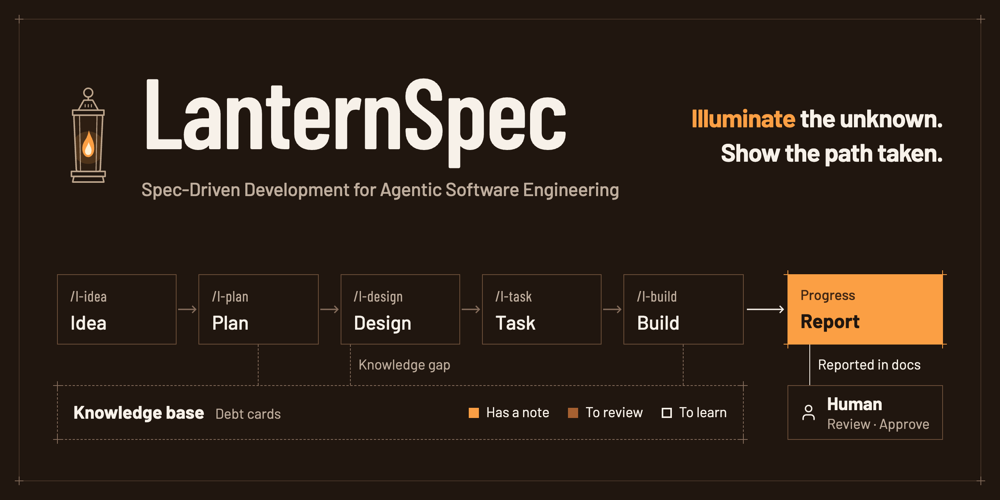
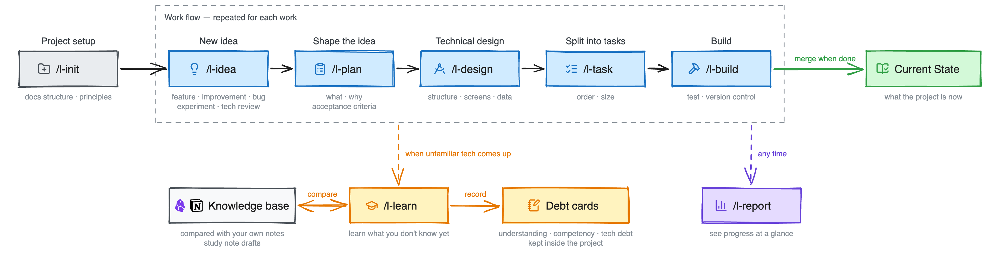

<div align="center">



<a href="https://pypi.org/project/lanternspec/"></a>
<a href="https://github.com/Jungjihyuk/LanternSpec"></a>
<a href="https://github.com/Jungjihyuk/LanternSpec/blob/main/LICENSE"></a>


**English** · [한국어](https://github.com/Jungjihyuk/LanternSpec/blob/main/README.ko.md)

[Install](#install) · [Quick start](#quick-start) · [Compared with other SDD tools](#compared-with-other-sdd-tools) · [Skills](#flow-and-skills) · [CLI](#cli-at-a-glance)

</div>

---

Hand the work to an AI agent and still be able to follow what was built, why, and how — all the way through.

- 📄 **Leaves familiar documents** — idea → plan → design → tasks → code, in the document formats teams already know
- 🏮 **Illuminates the unknown** — compares the technologies the AI used with your own knowledge base and tells you what to review and what to learn
- 📈 **Shows the path taken** — kanban, timeline and understanding-debt views, all readable in Obsidian

> **Language note:** the documents, skills and CLI messages LanternSpec produces are currently in **Korean**.

## Compared with other SDD tools

| | [Spec Kit](https://github.com/github/spec-kit) | [OpenSpec](https://github.com/Fission-AI/OpenSpec) | 🏮 **LanternSpec** |
|---|---|---|---|
| Flow | constitution → specify → plan → tasks → implement → converge | explore → propose → apply → archive | idea → plan → design → tasks → build (+ learn · report) |
| Documents | spec · plan · tasks per feature | proposal · requirements · design · tasks folder per change | 24 familiar document templates (plan, design, tasks, log …) |
| When done | repeat implementation until converged | merge requirements into specs and archive | merge into the "current state" docs after approval, then archive |
| Strengths | swap processes via extensions, presets and workflows; bug-fix and idea-assessment extensions | lightweight, no enforced phases, brownfield-first, cross-repo planning (beta) | compares unfamiliar tech with your knowledge base (understanding debt), progress reports, picks design principles for you |
| AI tools | many coding agents | 30+ | Claude Code · Codex · Antigravity |
| Install | Python 3.11+ · uv | single binary · npm · Homebrew | Python 3.12+ · uv |
| Document language | English (README in several languages) | English | Korean |

## Install

Requirements: Python 3.12+ · git · [uv](https://docs.astral.sh/uv/)

```bash
uv tool install lanternspec      # installs the lantern command
cd my-project
lantern install --language en    # installs skills, rules and hooks into this project (Claude Code by default)
```

Then call `/l-init` inside your AI tool (`$l-init` in Codex).

- **Language:** documents, skills and rules come in English (`--language en`) or Korean (the default). It is chosen at the first install and kept in `lantern.yaml`.
- **Using several AI tools:** `lantern install --language en --tools claude,codex,antigravity`
- **Skills live in your project:** they are written straight into the project, not installed as a plugin. So they are called without a prefix (`/l-init`) and shared with your team through git.
- **When a new version comes out:** `uv tool upgrade lanternspec` → `lantern upgrade`. If the version changed the documents' folder layout, it first shows what would move and stops — check it, then `lantern upgrade --apply` (moved with git so history continues, links rewritten, one commit)

## Quick start

```
/l-init                       answer a few questions → lantern.yaml · docs/ · draft project definition · design principles
/l-idea dark mode support     record an idea right away → 1. Ideas/IDEA-001
/l-plan IDEA-001              what and why, with acceptance criteria → 2. Work/W-001 …/Plan.md
/l-design W-001               how — only the structure, screens and data that change; a person approves
/l-task W-001                 an ordered task list
/l-build W-001                implement → test → one commit per task, report with evidence → merge into the current state
/l-pr                         open a pull request that fits the branch flow (if you use PRs)
/l-report                     kanban · timeline · debt · a three-line status report
```

`lantern` numbers every document in order.

| ID | Meaning |
|---|---|
| `IDEA-001` | idea #1 |
| `W-001` | work item #1 (one bundle from plan to build) |
| `W-001-T02` | the 2nd task of work item #1 |
| `D-001` · `ADR-001` | debt card · decision record |

### Commands for checking where you are

| Command | When to use it |
|---|---|
| `lantern status` | when you pick the work back up — shows the work in progress, the next task and open questions in three lines |
| `lantern doctor` | right after installing, or when something feels off — checks that install, settings and folders match `lantern.yaml`, and that each installed AI tool's version and hooks are working |
| `lantern --help` | when you forget a command — options per command with `lantern <command> --help` |

## Flow and skills

What the concepts in this document mean and where they are used is gathered in [Concepts](https://github.com/Jungjihyuk/LanternSpec/blob/main/CONCEPTS.md). To change LanternSpec itself, start with the [design rationale](https://github.com/Jungjihyuk/LanternSpec/blob/main/RATIONALE.md), which records why the flow, folders and rules are the way they are.



| Skill | What it does | What it leaves |
|---|---|---|
| `/l-init` | sets up the document structure and design principles from the questions the earlier answers call for (new or existing · team size · project kind · server · knowledge base · design tool · technology choice and so on), and picks the branch flow | `lantern.yaml`, `docs/`, project definition, MOC, design principles |
| `/l-idea` | records a thought from the conversation, as said and as summarised — each kind (feature · improvement · bug · experiment · tech review) has its own template, with the outcome filled in afterwards | `1. Ideas/IDEA-001 …` |
| `/l-plan` | what and why — a work folder and acceptance criteria | `2. Work/W-001 …/Plan.md` |
| `/l-design` | how — only the structure, screens and data (DBML) that change, wireframes, behind an approval gate | `Design.md`, `Screens/`, ADR |
| `/l-task` | an ordered task list (size 15m · 1h · 4h · 8h · acceptance criteria · dependencies · spike tasks) | `Tasks.md` |
| `/l-build` | implement → test → one commit per task, report **with evidence**, open and check screens itself, merge into the current state when done (in a parallel worktree, only its own tasks) | code, `Log.md` |
| `/l-learn` | compares unfamiliar tech with your knowledge base → 🟢 · 🟡 · 🔴, debt cards and draft study notes | `📒 Debt/Cards/D-001 …` |
| `/l-report` | kanban · timeline · domain · traceability · debt · docs-vs-code status + a three-line report | `4. Operations/Reports/Status Report.md` |
| `/l-template` | create, refine and migrate templates (without losing content) | `0. Templates/…` |
| `/l-check` | format check (required sections · values · links · versions · IDs · length) | — |
| `/l-sync` | finds where documents and code disagree and brings them back in line | — |
| `/l-map` | updates the MOC (document map) | `Docs MOC.md` |
| `/l-adr` | records decisions that are hard to reverse | `Decisions/ADR-001 …` |
| `/l-resume` | carries on an earlier conversation — from any AI tool, from where it stopped even if it was cut off | — |
| `/l-ref` | brings in company rules, glossaries and domain knowledge, indexes them by section and gets each section's use approved | the index, company rules in `AGENTS.md`, `Glossary.md` |
| `/l-domain` | when domain rules matter, finds the matching section in the index and reads just that section word for word | (the plan's "Domain Knowledge Used") |
| `/l-pr` | writes the title and body for the direction that fits the branch flow, and opens the PR once confirmed (never merges) | — |
| `/l-parallel` | before starting several works at once, checks what they must decide together and their order, records the decisions as ADRs, then opens a worktree per work | ADR |
| `/l-finish` | when parallel works are done, gathers person checks in the base folder, merges them one at a time, then updates the current state, archives and reports once | current state, `Archive/` |

### How it works
- **Scripts handle the format, the AI writes the content.** Numbering, files, folders, checks and status changes all go through the `lantern` command; the AI only writes content.
- **Every document starts from a template.** The AI fills in the template's `{{blanks}}`; changing the section structure is flagged immediately.
- **Every skill ends the same way.** A skill that changed documents runs `lantern close <skill>`: check → update the map → log the run.
- **Show before writing.** Designs and changes to the current state are summarised and approved first (`/l-idea` is the only exception).
- **Your knowledge base is read-only.** Notes are written only after you approve.

## Document structure

Documents are stored in one folder per work item, and the MOC (document map) collects them by stage. Folder and file names are Korean.

```
docs/
├─ Docs MOC.md           document map + view by stage (lantern map rewrites the marked part)
├─ 0. Templates/          templates you refine over time · _meta/enums.yaml (the single source of status and kind names)
├─ 1. Ideas/              ideas
├─ 2. Work/W-001 …/       plan · design · tasks · log — the only place edited while working
│   └─ Archive/           archive
├─ 3. Current State/     what the system looks like now — updated only when work is done, after approval
│   └─ Rules/ (Tech Selection Criteria · Task Breakdown Rules · Repository File Rules …) · Decisions/ · Deployment and Operations/ · Glossary …
├─ 4. Operations/        reports · session logs · (teams of 2+) meeting notes
├─ 5. Legacy Docs/       (existing projects) original documents, kept unchanged
├─ 📒 Debt/              understanding debt — one card per debt
└─ 📚 Domain Knowledge/  laws · policies · business rules (the Domain Knowledge MOC shows the index)
```

Which documents you get depends on your `/l-init` answers (`lantern.yaml`; check with `lantern profile docs`).

- A mobile app adds deployment and platform-integration documents.
- A team of two or more adds collaboration rules and meeting notes.

If you don't want documents on the remote, use `lantern docs-mode local`. Documents then live only on a `docs-local` branch in the same repository, and pushing that branch is blocked.

Sections lantern reads and writes (protected sections, such as "Now" in a log) may be renamed or deleted too. lantern doesn't put them back; `lantern check` asks whether it was on purpose (`lantern sections`). The list is in `0. Templates/_meta/Protected Sections.md`.

### Viewing the docs in Obsidian
Open the `docs/` folder as a vault in Obsidian and it is already set up for reading (`docs/.obsidian/`).
`lantern obsidian plugins` also adds Lantern Timeline, which shows the report's timeline as bars: stretches with work in fine columns (5 minutes to an hour), time with no task folded away, and how long each finished task took beside it. Tasks without a date wait with their size in a "no date yet" column on the right; drag one onto a day to plan it. Drag a planned task that has not started to move it, or drag its ends to change its length; the dates are saved in its planned and due attributes.
Lantern Kanban comes along too: works as cards in stage columns (plan · design · tasks · build · done), each opening its tasks in a window when clicked (read only). Turn off a view you don't want in Obsidian's settings, and reports draw without it.
The task list (`Tasks.md`) reads like a table: names on the left, size · after · criteria in columns on the right. The file keeps one line per task.

- **Folder colors, folder and file icons, callouts and quotes** — each document stage has its own folder color, folders and files get icons, and callouts and quotes look clean. Works on top of any theme.
- **Picking status and kind** — each document type offers only its own choices in a menu (Metadata Menu). The choices are generated from `enums.yaml`, so renaming a value updates them too.
- **Recommended plugins** — Dataview (shows `[start:: …]` fields in task lists) and Metadata Menu (choice menus). `/l-init` asks whether to download them; to do it later:

```bash
lantern obsidian plugins     # downloads the latest official release files of both plugins into docs/.obsidian/plugins/
```

When Obsidian first asks whether to turn on community plugins, turn them on (leave restricted mode). Plugin code and the window layout (`workspace.json`) stay out of git; only the settings are committed. Teammates run the same command.

### Branch flow

One work is one branch. `/l-init` asks how finished work gets merged, and `lantern work flow` works out the recommendation from the branches and remote.

| Flow | How it goes | Good for |
|---|---|---|
| A. Keep it simple | work → default branch | starting out, or building fast on your own |
| B. Separate development from deployment | work → `dev`, then a PR from `dev` to the default branch when deploying | a service that deploys as soon as the default branch changes |
| C. A PR for each work | work → PR → base branch | getting code reviews |
| D. Keep what you use now | records only where work merges; branches stay as they are | a project that already has a strategy |

Work branches are named `work/W-012` by default; change it with `git.branch` in `lantern.yaml`.

```yaml
git:
  branch: feature/{id}-{slug}   # → feature/W-012-login (blanks other than {id} are named for each work)
```

To run several works at once, check them with `/l-parallel`, run `/l-build` in each work's worktree in its own terminal, and merge them with `/l-finish` in the base folder once all are done.

## Supported AI tools

| Tool | Skills | Rules | Agent hooks | MCP (`--mcp`) |
|---|---|---|---|---|
| Claude Code | `.claude/skills` | `AGENTS.md` (an existing `CLAUDE.md` gets `@AGENTS.md`) | `.claude/settings.json` | `.mcp.json` |
| Codex | `.agents/skills` (`$l-…`) | `AGENTS.md` | `.codex/hooks.json` | `.codex/config.toml` |
| Antigravity CLI (`agy`) | `.agents/skills` | `AGENTS.md` | `.agents/hooks.json` (no save-before-compaction — there is no compaction hook) | `.agents/plugins/lanternspec/` |

- **Rules live in `AGENTS.md`.** LanternSpec manages only the `<!-- lanternspec:start -->` block inside it and leaves everything outside the block alone. When a file goes past what the installed tools read in full, `lantern doctor` tells you.
- **Codex and Antigravity share the skills folder.** When you use both, skill bodies say `/l-build`, and `AGENTS.md` tells Codex to use `$` instead.

## Keeping documents and code in line

git and AI tools already have **hooks**: they run a script at set moments (just before a commit, right after a file is written, and so on).

LanternSpec connects its checks to those hooks, so `lantern` checks at every stage that documents and code still match. The checks are done by a script, not by the AI, so they always apply the same rules.

| Stage | What it does | Example |
|---|---|---|
| While talking to the AI | shows where things stand when a session starts, and checks the format as soon as the AI writes a document | warns right away when the AI deletes a required section of a plan |
| Just before a commit | looks at what the commit contains and checks that the records that should go with it are there | warns when the database structure changed but the work log doesn't mention it |
| After the commit message | checks that the message says which task the commit belongs to | warns when the message has no task ID (e.g. `[W-001-T02]` = the 2nd task of work item #1) |
| Just before a push | checks that nothing that must stay local is being pushed | blocks pushing the documents branch you chose to keep off the remote |
| After pushing to GitHub | runs the same checks again on GitHub, whoever pushed (CI) | marks the run failed if document format, lint, type checks or tests break; on PRs it also looks for work IDs in the title and commits |
| On demand | scans past commits and lists where documents and code drifted apart (`lantern scan`) | documents not reviewed for a while although their code changed |

- **Warnings by default.** Work is never blocked. To make the commit checks blocking, set `git.hooks` to `block` in `lantern.yaml`.
- **Hard-to-undo mistakes are always blocked.** For example, pushing documents you chose to keep off the remote is blocked regardless of settings.

```bash
lantern hooks install            # turns on the commit and push checks (/l-init asks before installing)
lantern install --ci             # also checks on GitHub (turn off with --no-ci)
lantern install --pr-template    # adds a PR template for GitHub
lantern install --commit-template  # adds a commit message template and sets it for this clone
```

## References — company rules, terms and domain knowledge

Material people already have stays in its own form and is indexed by section, so the AI reads only the sections it needs (`/l-ref`). It can live inside the project or outside it (`~/…`).

| Material | When it is read | How |
|---|---|---|
| Company rules | always | each section's scope and strength are approved, then it goes word for word into the matching `AGENTS.md` |
| Terms | when needed | `lantern check` finds the glossary's "words to avoid" in the documents |
| Domain knowledge | only the section, only when needed | sections picked from the `📚 Domain Knowledge/` index are attached to a work's plan and read when their task starts |

- **Outside material never reaches git.** Its paths, titles and index all stay in `.lantern/`.
- **Sections are read by address.** `lantern ref read "Privacy#Retention period"`
- **Originals are read through copies.** `lantern ref convert --apply` turns PDF · Word · PowerPoint · HWP into Markdown cut into sections, and Excel · CSV into a card of sheets, columns and row counts, next to the original. It marks the quality too (HWP without headings or tables is "check it", a scanned PDF "no text"). PDF needs `pdftotext` (poppler).

## Managing unfamiliar tech — knowledge base and understanding debt

When the AI uses a technology you don't know, LanternSpec compares it with the notes in your knowledge base and sorts it into three groups.

- 🟢 you have a note → links the note
- 🟡 you have a note but asked again → tells you what to review
- 🔴 no note yet → suggests a draft study note

Anything you don't understand yet is kept as a debt card, and every time you ask about it again the count goes up.

| Knowledge base (`knowledge.type`) | How | Writing |
|---|---|---|
| `obsidian` · `folder` | reads Markdown files directly | creates notes after approval (drafts only with `propose_only`) |
| `notion` | planned | — |

Every knowledge base supports the same four actions: search · read · propose · write. The CLI (`lantern knowledge …`) and the MCP server (`lantern mcp`) use the same functions.

Folders of the knowledge base the AI must not open go in `knowledge.deny` in `lantern.yaml` (or list the only open ones in `knowledge.allow`). lantern neither searches nor reads closed folders. To also stop the AI tool from opening them directly, start it with `lantern guard -- claude`: the tool runs inside the operating system's sandbox (macOS, and Linux with bubblewrap; works with `claude` · `codex` · `agy`; on macOS the tool's own sandbox has to be off, and lantern turns Codex's off itself).

There are three kinds of debt.

| Kind | Meaning |
|---|---|
| 🧠 Understanding | you follow it when it's explained, but it isn't yours yet. Reopened if you ask again after resolving it |
| 🛠 Competency | you understand it but haven't done it yourself, or a blocked idea needs it. Practised with exercises (`lantern debt promote`) |
| 🧱 Technical | debt left in the code (technical debt) |

## Design principles and ways of working

### Design principles and code conventions
Picks design principles and code conventions from a table, based on the project kind chosen in `/l-init` and the measured size (lines of code · team size).

- Languages: Python · TypeScript · Swift · Rust · Go
- The essentials go into `AGENTS.md`; the full explanation goes into `Development Principles.md`.
- When two or more folders have their own package file (`pyproject.toml`, `package.json` …) (such as `backend` and `web`, `lantern parts`), each part gets its own `AGENTS.md` with its language conventions and check commands, and hooks hand it to tools that don't read folder `AGENTS.md` files themselves (Codex · Antigravity).
- In existing projects, lint and format settings already in use are recorded, never changed.
- When the code grows past a size boundary, `lantern doctor` asks whether to raise the principles one level.
- The language of code comments can be set apart from the documents with `project.comment_language`.
- See the result with `lantern principles show`; run lint and type checks with `lantern lint` (in each part's folder when there are parts)
- CI (`lantern install --ci`) prepares tools and checks in each part's folder. Leave a heavy part out with `ci: false` on that part in `lantern.yaml`. In existing projects, lint and type errors only warn at first and CI passes; once they are clean, set `build.ci_lint: block`.

### Build mode
`lantern build-mode suggest` looks at code size, work in progress, whether tests exist and past runs, and recommends **one axis at a time**.

- **Loop scope:** check each task (the default for small projects) or loop automatically until the acceptance tests pass — `--apply` sets `build.loop`
- **Task delegation:** whether to hand `[P]` tasks that don't depend on each other in one work to sub-agents
- **Parallel works:** whether to run different works at once in worktrees (checked with `/l-parallel`)

### Evaluation
`lantern eval` uses the run log to compare cost (time · tool calls) and results (format errors at wrap-up) per skill, model and setting.

### Design tools
Claude Design: in Claude Code, the AI draws wireframes on a Design canvas itself. Figma and Canva work through each tool's MCP.
Import mockups with `lantern screen import`; `lantern screen compare` finds where the built screen differs from the mockup.
`/l-build` opens built screens with the AI tool's browser to check them, and leaves "waiting for a person" when it can't (`verify.browser`). Whether a screen matches the mockup is a person's call.

## CLI at a glance

```text
setup      install [--language] [--tools] [--mcp] [--ci|--no-ci] [--pr-template] [--commit-template] · upgrade [--apply] · doctor · build-mode suggest · guard -- <tool>
profile    profile show|docs|write|set · principles show|detect · parts [add|ignore] · enums list|rename · sections list|rename|off|on
documents  scaffold init [--plan] | work | doc | idea | adr | meeting | custom · new-id · map · meta get|set
checks     check [--changed] [--epic W-012] · check-pr · lint [--ci] · check-dbml · dbml render|from-sql|diff
work       task next [--all]|start|done|ac|list|estimate · task add [--parallel] [--spike] · pack · screen import|compare
           work branch|start|list|overlap|finish|archive|stage|flow · design approve · unit-log add · idea find|status
learning   knowledge search|read|propose|write|areas · debt find|new|ask|resolve|promote|practice|known|status|list · mcp
reports    report [--views] [--summary] · status · resume [--session] [--more] · scan [--tests] [--ci] · sync adopt · eval · obsidian plugins
templates  template list|show|lint|level|bump|outdated|diff|usage|new|migrate · legacy adopt|todos
references ref list|check|index|read · tag|exclude|rules · terms|term|glossary|candidate · domain|describe|attach · convert [--apply]|preview
git        hooks install|uninstall|status · docs-mode local|shared
wrap-up    close <skill>
```

## License

[MIT](https://github.com/Jungjihyuk/LanternSpec/blob/main/LICENSE)
