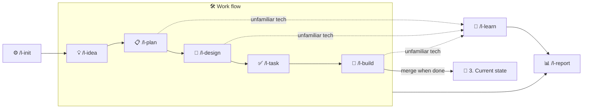

<div align="center">


<a href="https://pypi.org/project/lanternspec/"></a>
<a href="https://github.com/Jungjihyuk/LanternSpec"></a>
<a href="https://github.com/Jungjihyuk/LanternSpec/blob/main/LICENSE"></a>


**English** · [한국어](https://github.com/Jungjihyuk/LanternSpec/blob/main/README.ko.md)

[Install](#install) · [Quick start](#quick-start) · [Compared with other SDD tools](#compared-with-other-sdd-tools) · [Skills](#flow-and-skills) · [CLI](#cli-at-a-glance)

</div>

---

Hand the work to an AI agent and still be able to follow what was built, why, and how — all the way through.

- 📄 **Leaves familiar documents** — idea → plan → design → tasks → code, in the document formats teams already know
- 🏮 **Illuminates the unknown** — compares the technologies the AI used with your own knowledge base and tells you what to review and what to learn
- 📈 **Shows the path taken** — kanban, timeline and understanding-debt views, all readable in Obsidian

> **Language note:** the documents, skills and CLI messages LanternSpec produces are currently in **Korean**.

## Compared with other SDD tools

| | [Spec Kit](https://github.com/github/spec-kit) | [OpenSpec](https://github.com/Fission-AI/OpenSpec) | 🏮 **LanternSpec** |
|---|---|---|---|
| Flow | constitution → specify → plan → tasks → implement → converge | explore → propose → apply → archive | idea → plan → design → tasks → build (+ learn · report) |
| Documents | spec · plan · tasks per feature | proposal · requirements · design · tasks folder per change | 24 familiar document templates (plan, design, tasks, log …) |
| When done | repeat implementation until converged | merge requirements into specs and archive | merge into the "current state" docs after approval, then archive |
| Strengths | swap processes via extensions, presets and workflows; bug-fix and idea-assessment extensions | lightweight, no enforced phases, brownfield-first, cross-repo planning (beta) | compares unfamiliar tech with your knowledge base (understanding debt), progress reports, picks design principles for you |
| AI tools | many coding agents | 30+ | Claude Code · Codex · Antigravity |
| Install | Python 3.11+ · uv | single binary · npm · Homebrew | Python 3.12+ · uv |
| Document language | English (README in several languages) | English | Korean |

## Install

Requirements: Python 3.12+ · git · [uv](https://docs.astral.sh/uv/)

```bash
uv tool install lanternspec      # installs the lantern command
cd my-project
lantern install --language en    # installs skills, rules and hooks into this project (Claude Code by default)
```

Then call `/l-init` inside your AI tool (`$l-init` in Codex).

- **Language:** documents, skills and rules come in English (`--language en`) or Korean (the default). It is chosen at the first install and kept in `lantern.yaml`.
- **Using several AI tools:** `lantern install --language en --tools claude,codex,antigravity`
- **Skills live in your project:** they are written straight into the project, not installed as a plugin. So they are called without a prefix (`/l-init`) and shared with your team through git.
- **When a new version comes out:** `uv tool upgrade lanternspec` → `lantern upgrade`

## Quick start

```
/l-init                       answer 7 questions → lantern.yaml · docs/ · draft project definition · design principles
/l-idea dark mode support     record an idea right away → 1. Ideas/IDEA-001
/l-plan IDEA-001              what and why, with acceptance criteria → 2. Work/W-001 …/Plan.md
/l-design W-001               how — only the structure, screens and data that change; a person approves
/l-task W-001                 an ordered task list
/l-build W-001                implement → test → one commit per task, report with evidence → merge into the current state
/l-report                     kanban · timeline · debt · a three-line status report
```

`lantern` numbers every document in order.

| ID | Meaning |
|---|---|
| `IDEA-001` | idea #1 |
| `W-001` | work item #1 (one bundle from plan to build) |
| `W-001-T02` | the 2nd task of work item #1 |
| `D-001` · `ADR-001` | debt card · decision record |

### Commands for checking where you are

| Command | When to use it |
|---|---|
| `lantern status` | when you pick the work back up — shows the work in progress, the next task and open questions in three lines |
| `lantern doctor` | right after installing, or when something feels off — checks that install, settings and folders match `lantern.yaml` |
| `lantern --help` | when you forget a command — options per command with `lantern <command> --help` |

## Flow and skills



| Skill | What it does | What it leaves |
|---|---|---|
| `/l-init` | sets up the document structure and design principles from 7 questions (new or existing · team size · screens · server · knowledge base · design tool · project kind) | `lantern.yaml`, `docs/`, project definition, MOC, design principles |
| `/l-idea` | records a thought from the conversation, as said and as summarised | `1. Ideas/IDEA-001 …` |
| `/l-plan` | what and why — a work folder and acceptance criteria | `2. Work/W-001 …/Plan.md` |
| `/l-design` | how — only the structure, screens and data (DBML) that change, behind an approval gate | `Design.md`, `Screens/`, ADR |
| `/l-task` | an ordered task list (size · acceptance criteria · dependencies) | `Tasks.md` |
| `/l-build` | implement → test → one commit per task, report **with evidence**, merge into the current state when done | code, `Log.md` |
| `/l-learn` | compares unfamiliar tech with your knowledge base → 🟢 · 🟡 · 🔴, debt cards and draft study notes | `📒 Debt/Cards/D-001 …` |
| `/l-report` | kanban · timeline · domain · traceability · debt · docs-vs-code status + a three-line report | `4. Operations/Reports/Status Report.md` |
| `/l-template` | create, refine and migrate templates (without losing content) | `0. Templates/…` |
| `/l-check` | format check (required sections · values · links · versions · IDs · length) | — |
| `/l-sync` | finds where documents and code disagree and brings them back in line | — |
| `/l-map` | updates the MOC (document map) | `Docs MOC.md` |
| `/l-adr` | records decisions that are hard to reverse | `Rules and Decisions/ADR-001 …` |

### How it works
- **Scripts handle the format, the AI writes the content.** Numbering, files, folders, checks and status changes all go through the `lantern` command; the AI only writes content.
- **Every document starts from a template.** The AI fills in the template's `{{blanks}}`; changing the section structure is flagged immediately.
- **Every skill ends the same way.** A skill that changed documents runs `lantern close <skill>`: check → update the map → log the run.
- **Show before writing.** Designs and changes to the current state are summarised and approved first (`/l-idea` is the only exception).
- **Your knowledge base is read-only.** Notes are written only after you approve.

## Document structure

Documents are stored in one folder per work item, and the MOC (document map) collects them by stage. Folder and file names are Korean.

```
docs/
├─ Docs MOC.md           document map + view by stage (lantern map rewrites the marked part)
├─ 0. Templates/          templates you refine over time · _meta/enums.yaml (the single source of status and kind names)
├─ 1. Ideas/              ideas
├─ 2. Work/W-001 …/       plan · design · tasks · log — the only place edited while working
│   └─ Archive/           archive
├─ 3. Current State/     what the system looks like now — updated only when work is done, after approval
├─ 4. Operations/        reports · session logs · (teams of 2+) meeting notes
├─ 5. Legacy Docs/       (existing projects) original documents, kept unchanged
└─ 📒 Debt/              understanding debt — one card per debt
```

Which documents you get depends on your `/l-init` answers (`lantern.yaml`; check with `lantern profile docs`).

- A mobile app adds deployment and platform-integration documents.
- A team of two or more adds collaboration rules and meeting notes.

If you don't want documents on the remote, use `lantern docs-mode local`. Documents then live only on a `docs-local` branch in the same repository, and pushing that branch is blocked.

### Viewing the docs in Obsidian
Open the `docs/` folder as a vault in Obsidian and it is already set up for reading (`docs/.obsidian/`).

- **Folder colors, callouts and quotes** — each document stage has its own folder color, and callouts and quotes look clean. Works on top of any theme.
- **Picking status and kind** — each document type offers only its own choices in a menu (Metadata Menu). The choices are generated from `enums.yaml`, so renaming a value updates them too.
- **Recommended plugins** — Dataview (shows `[start:: …]` fields in task lists) and Metadata Menu (choice menus). `/l-init` asks whether to download them; to do it later:

```bash
lantern obsidian plugins     # downloads the latest official release files of both plugins into docs/.obsidian/plugins/
```

When Obsidian first asks whether to turn on community plugins, turn them on (leave restricted mode). Plugin code and the window layout (`workspace.json`) stay out of git; only the settings are committed. Teammates run the same command.

## Supported AI tools

| Tool | Skills | Rules | Agent hooks | MCP (`--mcp`) |
|---|---|---|---|---|
| Claude Code | `.claude/skills` | `CLAUDE.md` → `@AGENTS.md` | `.claude/settings.json` | `.mcp.json` |
| Codex | `.agents/skills` (`$l-…`) | `AGENTS.md` | `.codex/hooks.json` | `.codex/config.toml` |
| Antigravity CLI (`agy`) | `.agents/skills` | `AGENTS.md` | `.agents/hooks.json` (no save-before-compaction — there is no compaction hook) | `.agents/plugins/lanternspec/` |

- **Rules live in `AGENTS.md`.** LanternSpec manages only the `<!-- lanternspec:start -->` block inside it and leaves everything outside the block alone.
- **Codex and Antigravity share the skills folder.** When you use both, skill bodies say `/l-build`, and `AGENTS.md` tells Codex to use `$` instead.

## Keeping documents and code in line

git and AI tools already have **hooks**: they run a script at set moments (just before a commit, right after a file is written, and so on).

LanternSpec connects its checks to those hooks, so `lantern` checks at every stage that documents and code still match. The checks are done by a script, not by the AI, so they always apply the same rules.

| Stage | What it does | Example |
|---|---|---|
| While talking to the AI | shows where things stand when a session starts, and checks the format as soon as the AI writes a document | warns right away when the AI deletes a required section of a plan |
| Just before a commit | looks at what the commit contains and checks that the records that should go with it are there | warns when the database structure changed but the work log doesn't mention it |
| After the commit message | checks that the message says which task the commit belongs to | warns when the message has no task ID (e.g. `[W-001-T02]` = the 2nd task of work item #1) |
| Just before a push | checks that nothing that must stay local is being pushed | blocks pushing the documents branch you chose to keep off the remote |
| After pushing to GitHub | runs the same checks again on GitHub, whoever pushed (CI) | marks the run failed if document format, lint, type checks or tests break |
| On demand | scans past commits and lists where documents and code drifted apart (`lantern scan`) | documents not reviewed for a while although their code changed |

- **Warnings by default.** Work is never blocked. To make the commit checks blocking, set `git.hooks` to `block` in `lantern.yaml`.
- **Hard-to-undo mistakes are always blocked.** For example, pushing documents you chose to keep off the remote is blocked regardless of settings.

```bash
lantern hooks install            # turns on the commit and push checks (/l-init asks before installing)
lantern install --ci             # also checks on GitHub (turn off with --no-ci)
```

## Managing unfamiliar tech — knowledge base and understanding debt

When the AI uses a technology you don't know, LanternSpec compares it with the notes in your knowledge base and sorts it into three groups.

- 🟢 you have a note → links the note
- 🟡 you have a note but asked again → tells you what to review
- 🔴 no note yet → suggests a draft study note

Anything you don't understand yet is kept as a debt card, and every time you ask about it again the count goes up.

| Knowledge base (`knowledge.type`) | How | Writing |
|---|---|---|
| `obsidian` · `folder` | reads Markdown files directly | creates notes after approval (drafts only with `propose_only`) |
| `notion` | planned | — |

Every knowledge base supports the same four actions: search · read · propose · write. The CLI (`lantern knowledge …`) and the MCP server (`lantern mcp`) use the same functions.

There are three kinds of debt.

| Kind | Meaning |
|---|---|
| 🧠 Understanding | you follow it when it's explained, but it isn't yours yet. Reopened if you ask again after resolving it |
| 🛠 Competency | you understand it but haven't done it yourself. Practised with exercises (`lantern debt promote`) |
| 🧱 Technical | debt left in the code (technical debt) |

## Design principles and ways of working

### Design principles and code conventions
Picks design principles and code conventions from a table, based on the project kind chosen in `/l-init` and the measured size (lines of code · team size).

- Languages: Python · TypeScript · Swift · Rust · Go
- The essentials go into `AGENTS.md`; the full explanation goes into `Development Principles.md`.
- In existing projects, lint and format settings already in use are recorded, never changed.
- When the code grows past a size boundary, `lantern doctor` asks whether to raise the principles one level.
- See the result with `lantern principles show`; run lint and type checks with `lantern lint`

### How the AI works
`lantern harness suggest` looks at code size, work in progress, whether tests exist and past runs, and recommends one of three modes.

- **Harness:** small loops inside one task. The default for small projects
- **Loop:** reruns the whole work item until the acceptance tests pass
- **Graph:** splits independent work items into worktrees so several agents work at the same time

### Evaluation
`lantern eval` uses the run log to compare cost (time · tool calls) and results (format errors at wrap-up) per skill, model and setting.

### Design tools
Claude Design, Figma and Canva through each tool's MCP.
Import mockups with `lantern screen import`; `lantern screen compare` finds where the built screen differs from the mockup.

## CLI at a glance

```text
setup      install [--tools] [--mcp] [--ci|--no-ci] · upgrade · doctor · harness suggest
profile    profile show|docs|write|set · principles show|detect · enums list|rename
documents  scaffold init [--plan] | work | doc | idea | adr | meeting | custom · new-id · map · meta get|set
checks     check [--changed] [--epic W-012] · lint · check-dbml · dbml render|from-sql|diff
work       task next [--all]|start|done|ac|list|estimate · task add [--parallel] · pack · screen import|compare
           work branch|start|list|finish|archive|stage · design approve · unit-log add · idea find|status
learning   knowledge search|read|propose|write|areas · debt find|new|ask|resolve|promote|practice|known|status|list · mcp
reports    report [--views] [--summary] · status · scan [--tests] · sync adopt · eval · obsidian plugins
templates  template list|lint|level|bump|outdated|diff|usage|new|migrate · legacy adopt|todos
git        hooks install|uninstall|status · docs-mode local|shared
wrap-up    close <skill>
```

## License

[MIT](https://github.com/Jungjihyuk/LanternSpec/blob/main/LICENSE)
