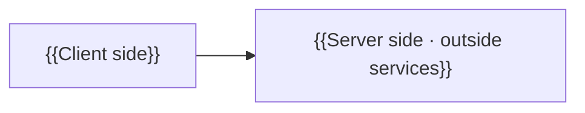

# 📘 Architecture

> [!abstract] At a glance
> {{The parts of the system and how they flow, in one sentence (required)}}

## Overview
> [!guide] 🟦 Source section · The client side plus the server side (if any), as parts. Draw it with Mermaid.

## Parts
| Part | What it does | Code location | Technology |
|---|---|---|---|
| {{Part}} | {{What it does}} | `{{Path}}` | {{Technology}} |

## Main flows
> [!guide] 🟦 Source section · Only flows that cross several parts, such as sign-in or sync.

{{Main flows}}

<!-- lantern:template-only -->
## Changelog
| Version | Date | What changed |
|---|---|---|
| 1.0.0 | 2026-10-27 | Base template |
