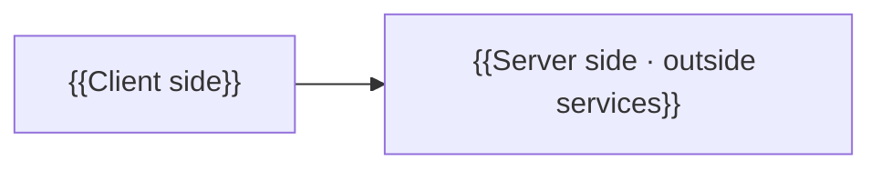

# 📘 Architecture

> [!abstract] At a glance
> {{The parts of the system and how they flow, in one sentence (required)}}

## Overview
> [!guide] Draw the screen side (app, web …) and, if any, the server and outside services as boxes, joined by arrows in the direction they talk (Mermaid).

## Parts
| Part | What it does | Code location | Technology |
|---|---|---|---|
| {{Part}} | {{What it does}} | `{{Path}}` | {{Technology}} |

## Main flows
> [!guide] Only flows that pass through several parts, such as sign-in or sync. Leave out what happens inside one part.

{{Main flows}}

<!-- lantern:template-only -->
## Changelog
| Version | Date | What changed |
|---|---|---|
| 1.0.0 | 2026-10-27 | Base template |
| 1.0.1 | 2026-11-02 | Clearer writing guides (long ones split into lines, symbols and internal names in words) |
