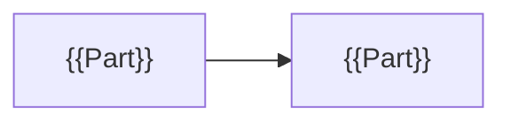

# 📐 ${work_id} ${name} — Design

> [!abstract] At a glance
> {{At a glance (required)}}

> [!guide] Write **only what changes** in this work. Of the three sections (🏗 Structure · 🎨 Screens · 🗄 Data), delete the ones you don't need, and list the ones you keep in frontmatter `parts` (e.g. `[structure, data]`). Once approved: `approved: "date name"`.

## 🏗 Structure
> [!guide] 🟦 Source section · The parts and flows that change, as Mermaid. The text explains the diagram.



{{Structure notes}}

## 🎨 Screens
> [!guide] 🟦 Source section · Mockups come only as **files** (images · HTML exports) under the work's `Screens/` folder. Share links are not accepted. **The picture is the source**; the text explains it.

| Screen | Mockup file | Notes |
|---|---|---|
| {{Screen name}} | `Screens/{{File}}` | {{Notes}} |

## 🗄 Data
> [!guide] 🟦 Source section · Only the **changes** against the current ERD (`3. Current State/Data/schema.dbml`), in DBML. `/l-build` merges them into the source when done. Check with `lantern check-dbml`.

```dbml
// {{Tables that change}}
```

| Change | Table · column | Why |
|---|---|---|
| {{Add · change · remove}} | {{Target}} | {{Why}} |

**Migration plan:** {{Migration plan}}

## Hard-to-reverse choices
> [!guide] If this changes a database, framework, auth method, outside service, data structure or public API, write it here and record the decision with `/l-adr`. Otherwise "None".

{{Hard-to-reverse choices}}

<!-- lantern:template-only -->
## Changelog
| Version | Date | What changed |
|---|---|---|
| 1.0.0 | 2026-10-27 | Base template |
