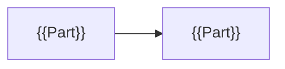

# 📐 ${work_id} ${name} — Design

> [!abstract] At a glance
> {{How you decided to build it, in one sentence (required)}}

> [!guide]- ✍️ How to write — only what changes
> Write **only what changes** in this work.
> - Of 🏗 Structure · 🎨 Screens · 🗄 Data, delete the sections you don't need
> - List the ones you keep in the `parts` property at the top (e.g. `[structure, data]`)
> - When a person approves it, `lantern design approve` writes the date and name into `approved`

## 🏗 Structure
> [!guide]- ✍️ How to write — a diagram of what changes
> Draw the parts and flows that change with Mermaid; the text explains the diagram.



{{Structure notes}}

## 🎨 Screens
> [!guide]- ✍️ How to write — the picture is the reference
> The **picture** is the reference; the text explains it.
> - Keep mockups as files (images · HTML) under the work's `Screens/` folder and link them
> - Note canvas or Figma links for reference only. They may change or stop opening later, so the files are the source

| Screen | Mockup file | Notes |
|---|---|---|
| {{Screen name}} | `Screens/{{File}}` | {{Notes}} |

## 🗄 Data
> [!guide]- ✍️ How to write — only changed tables and columns
> Write in DBML **only the tables and columns that change** from the current data structure (`3. Current State/Data/schema.dbml`).
> - When the work is done, `/l-build` merges them into `schema.dbml`
> - Check the syntax with `lantern check-dbml`

```dbml
// {{Tables that change}}
```

| Change | Table · column | Why |
|---|---|---|
| {{Add · change · remove}} | {{Target}} | {{Why}} |

**Migration plan:** {{Migration plan}}

## Hard-to-reverse choices
> [!guide]- ✍️ How to write — choices hard to undo
> If there is a choice that will be hard to undo later, write it here and record the decision with `/l-adr`. Otherwise "None".
> For example: choosing or changing a database · framework · auth method · outside service, or changing the data structure or a public API

{{Hard-to-reverse choices}}

<!-- lantern:template-only -->
## Changelog
| Version | Date | What changed |
|---|---|---|
| 1.0.0 | 2026-10-27 | Base template |
| 1.0.1 | 2026-11-02 | Clearer writing guides (long ones split into lines, symbols and internal names in words) |
| 1.0.2 | 2026-11-06 | Canvas · Figma links noted for reference, files as the source |
| 1.0.3 | 2026-11-11 | Notes folded, under titles that say what they are |
