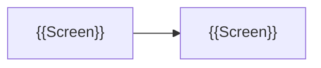

# 📘 Screens

> [!abstract] At a glance
> {{How the screens fit together, in one sentence (required)}}

> [!guide]- ✍️ How to write — the picture is the reference
> The **picture** is the reference; the text explains it.
> - Keep mockups as files (images · HTML exports) in this folder and link them
> - Don't use share links such as Figma's. They may change or stop opening later

## Screen list
| Screen | Mockup | What it does | From work |
|---|---|---|---|
| {{Screen}} | `{{File}}` | {{What it does}} | {{Work link}} |

## Screen flow

<!-- lantern:template-only -->
## Changelog
| Version | Date | What changed |
|---|---|---|
| 1.0.0 | 2026-10-27 | Base template |
| 1.0.1 | 2026-11-02 | Clearer writing guides (long ones split into lines, symbols and internal names in words) |
| 1.0.2 | 2026-11-11 | Notes folded, under titles that say what they are |
