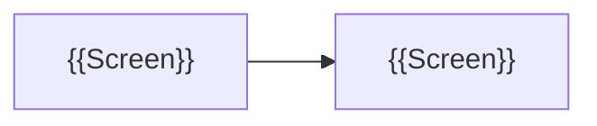

# 📘 Screens

> [!abstract] At a glance
> {{How the screens fit together, in one sentence (required)}}

> [!guide] **The picture is the source**; the text explains it. Keep mockup files (images · HTML exports) in this folder and link them. Share links are not accepted.

## Screen list
| Screen | Mockup | What it does | From work |
|---|---|---|---|
| {{Screen}} | `{{File}}` | {{What it does}} | {{Work link}} |

## Screen flow

<!-- lantern:template-only -->
## Changelog
| Version | Date | What changed |
|---|---|---|
| 1.0.0 | 2026-10-27 | Base template |
