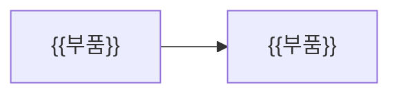

# 📐 ${work_id} ${name} — 설계

> [!abstract] 한눈에 보기
> {{한눈에 보기 (필수)}}

> [!guide] 이번 작업에서 **바뀌는 부분만** 쓴다. 세 칸(🏗 구조 · 🎨 화면 · 🗄 데이터) 중 필요 없는 칸은 지운다. 고른 칸은 frontmatter `parts`에 적는다 (예: `[구조, 데이터]`). 승인을 받으면 `approved: "날짜 이름"`.

## 🏗 구조
> [!guide] 🟦 원본 칸 · 바뀌는 부품과 흐름을 Mermaid로. 글은 그림을 설명한다.



{{구조 설명}}

## 🎨 화면
> [!guide] 🟦 원본 칸 · 시안은 작업 폴더 `화면/` 아래 **파일**(이미지 · HTML 내보내기)로만 받는다. 공유 링크는 받지 않는다. **그림이 원본**, 글은 설명.

| 화면 | 시안 파일 | 설명 |
|---|---|---|
| {{화면 이름}} | `화면/{{파일}}` | {{설명}} |

## 🗄 데이터
> [!guide] 🟦 원본 칸 · 현재 ERD(`3. 현재 상태/데이터/schema.dbml`) 대비 **변경분**만 DBML로. 끝나면 `/l-build`가 원본에 합친다. `lantern check-dbml`로 검사.

```dbml
// {{변경되는 테이블}}
```

| 변경 | 테이블 · 컬럼 | 이유 |
|---|---|---|
| {{추가 · 변경 · 삭제}} | {{대상}} | {{이유}} |

**마이그레이션 계획:** {{마이그레이션 계획}}

## 되돌리기 어려운 선택
> [!guide] DB · 프레임워크 · 인증 방식 · 외부 서비스 · 데이터 구조 · 공개 API 변경이 있으면 적고 `/l-adr`로 결정 기록을 남긴다. 없으면 "없음".

{{되돌리기 어려운 선택}}

<!-- lantern:template-only -->
## 변경 기록
| 버전 | 날짜 | 무엇이 바뀌었나 |
|---|---|---|
| 1.0.0 | 2026-10-27 | 기본 양식 |
