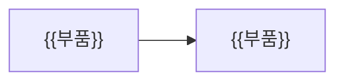

# 📐 ${work_id} ${name} — 설계

> [!abstract] 한눈에 보기
> {{어떻게 만들기로 했는지 한 문장 (필수)}}

> [!guide]- ✍️ 문서 작성법 — 바뀌는 부분만
> 이번 작업에서 **바뀌는 부분만** 쓴다.
> - 🏗 구조 · 🎨 화면 · 🗄 데이터 중 필요 없는 칸은 지운다
> - 남긴 칸은 맨 위 속성 `parts`에 적는다 (예: `[구조, 데이터]`)
> - 사람이 승인하면 `lantern design approve`가 `approved`에 날짜와 이름을 적는다

## 🏗 구조
> [!guide]- ✍️ 문서 작성법 — 바뀌는 부품과 흐름 그림
> 바뀌는 부품과 흐름을 Mermaid로 그리고, 글은 그림을 설명한다.



{{구조 설명}}

## 🎨 화면
> [!guide]- ✍️ 문서 작성법 — 그림이 기준
> 기준은 **그림**이고, 글은 그림을 설명한다.
> - 시안은 파일(이미지 · HTML)로 작업 폴더 `화면/` 아래에 두고 링크한다
> - 캔버스나 Figma 링크는 참고로만 적는다. 나중에 바뀌거나 열리지 않을 수 있어 파일이 원본이다

| 화면 | 시안 파일 | 설명 |
|---|---|---|
| {{화면 이름}} | `화면/{{파일}}` | {{설명}} |

## 🗄 데이터
> [!guide]- ✍️ 문서 작성법 — 바뀌는 테이블 · 컬럼만
> 지금 데이터 구조(`3. 현재 상태/데이터/schema.dbml`)에서 **바뀌는 테이블 · 컬럼만** DBML로 쓴다.
> - 작업이 끝나면 `/l-build`가 `schema.dbml`에 합친다
> - 문법은 `lantern check-dbml`로 확인한다

```dbml
// {{변경되는 테이블}}
```

| 변경 | 테이블 · 컬럼 | 이유 |
|---|---|---|
| {{추가 · 변경 · 삭제}} | {{대상}} | {{이유}} |

**마이그레이션 계획:** {{마이그레이션 계획}}

## 되돌리기 어려운 선택
> [!guide]- ✍️ 문서 작성법 — 되돌리기 어려운 선택
> 나중에 되돌리기 어려운 선택이 있으면 적고, `/l-adr`로 결정 기록을 남긴다. 없으면 "없음".
> 예: DB · 프레임워크 · 인증 방식 · 외부 서비스를 고르거나 바꿀 때, 데이터 구조나 공개 API를 바꿀 때

{{되돌리기 어려운 선택}}

<!-- lantern:template-only -->
## 변경 기록
| 버전 | 날짜 | 무엇이 바뀌었나 |
|---|---|---|
| 1.0.0 | 2026-10-27 | 기본 양식 |
| 1.0.1 | 2026-11-02 | 안내를 읽기 쉽게 다듬음 (긴 안내는 여러 줄로, 기호와 내부 이름은 말로) |
| 1.0.2 | 2026-11-06 | 캔버스 · Figma 링크는 참고로 적고 파일을 원본으로 |
| 1.0.3 | 2026-11-11 | 안내를 접어 두고, 무엇인지 보이는 제목을 붙임 |
