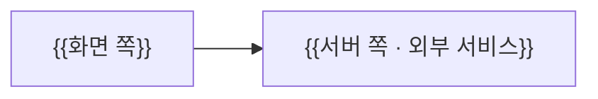

# 📘 시스템 구조

> [!abstract] 한눈에 보기
> {{시스템을 이루는 부품과 흐름 한 문장 (필수)}}

## 구성도
> [!guide] 🟦 원본 칸 · 화면 쪽(클라이언트) + 서버 쪽(있으면)을 부품으로. Mermaid로 그린다.

## 부품
| 부품 | 하는 일 | 코드 위치 | 기술 |
|---|---|---|---|
| {{부품}} | {{하는 일}} | `{{경로}}` | {{기술}} |

## 주요 흐름
> [!guide] 🟦 원본 칸 · 로그인 · 동기화처럼 여러 부품을 지나는 흐름만.

{{주요 흐름}}

<!-- lantern:template-only -->
## 변경 기록
| 버전 | 날짜 | 무엇이 바뀌었나 |
|---|---|---|
| 1.0.0 | 2026-10-27 | 기본 양식 |
