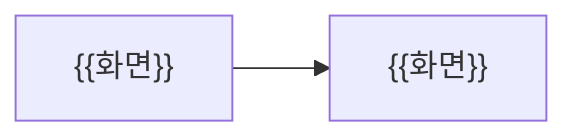

# 📘 화면

> [!abstract] 한눈에 보기
> {{화면 구성 한 문장 (필수)}}

> [!guide] **그림이 원본**이고 글은 설명이다. 시안 파일(이미지 · HTML 내보내기)은 이 폴더에 두고 링크한다. 공유 링크는 받지 않는다.

## 화면 목록
| 화면 | 시안 | 하는 일 | 출처 작업 |
|---|---|---|---|
| {{화면}} | `{{파일}}` | {{하는 일}} | {{작업 링크}} |

## 화면 흐름

<!-- lantern:template-only -->
## 변경 기록
| 버전 | 날짜 | 무엇이 바뀌었나 |
|---|---|---|
| 1.0.0 | 2026-10-27 | 기본 양식 |
