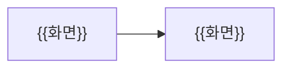

# 📘 화면

> [!abstract] 한눈에 보기
> {{화면 구성 한 문장 (필수)}}

> [!guide] 기준은 **그림**이고, 글은 그림을 설명한다.
> - 시안은 파일(이미지 · HTML 내보내기)로 이 폴더에 두고 링크한다
> - Figma 같은 공유 링크는 쓰지 않는다. 나중에 바뀌거나 열리지 않을 수 있다

## 화면 목록
| 화면 | 시안 | 하는 일 | 출처 작업 |
|---|---|---|---|
| {{화면}} | `{{파일}}` | {{하는 일}} | {{작업 링크}} |

## 화면 흐름

<!-- lantern:template-only -->
## 변경 기록
| 버전 | 날짜 | 무엇이 바뀌었나 |
|---|---|---|
| 1.0.0 | 2026-10-27 | 기본 양식 |
| 1.0.1 | 2026-11-02 | 안내를 읽기 쉽게 다듬음 (긴 안내는 여러 줄로, 기호와 내부 이름은 말로) |
